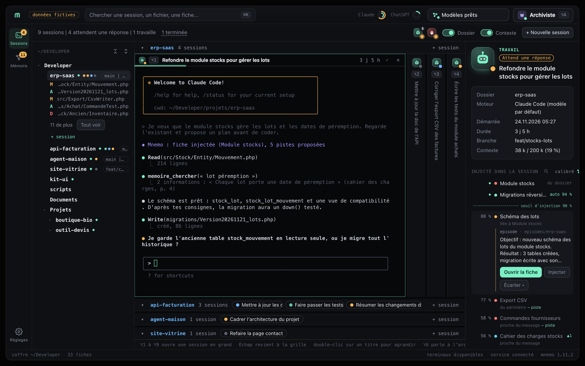
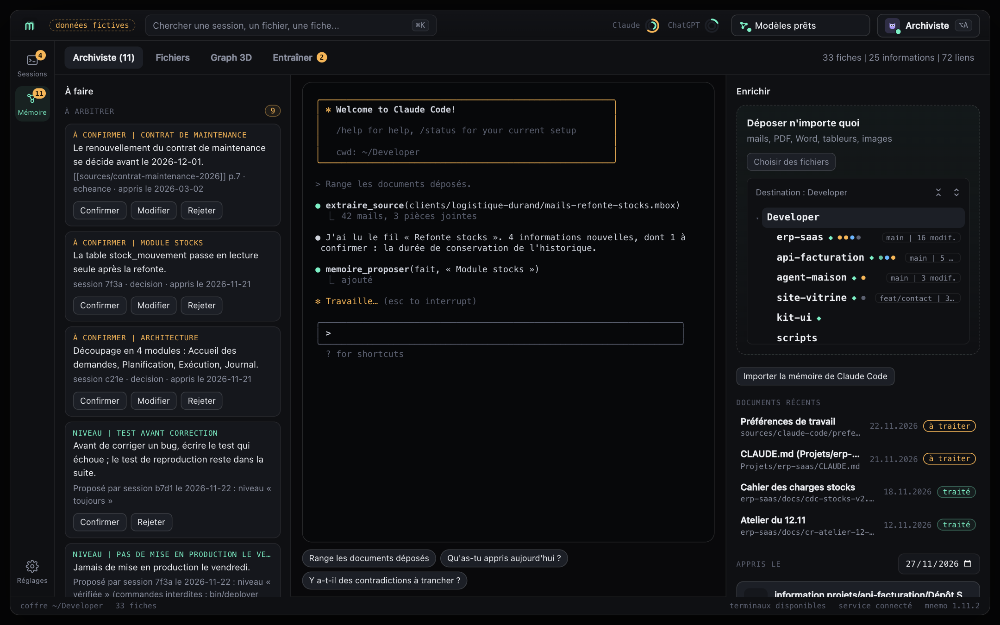
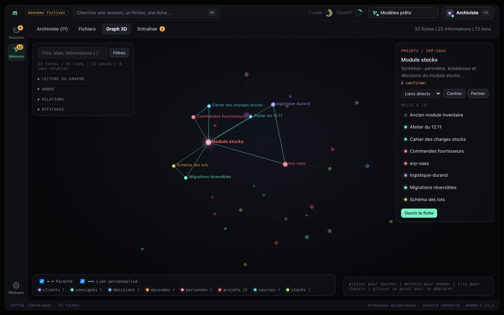

# Mnemo

Mnemo is an IDE for working with coding agent sessions (Claude Code, Codex and Mistral Vibe) rather than with files.
Your sessions run side by side in one window, each in its own terminal; they share a memory you can read, edit and
clean up; and for each session you see what it has been given from that memory.

The memory is a plain folder of Markdown notes, versioned with git. The agent reads from it at each message and writes
to it as it learns; every change is a commit you can see. At each message, Mnemo searches that memory locally (words,
meaning, links between notes, the project you are in, your past gestures), proposes a few ranked leads and injects whole
only the notes it is sure of, never a wall of text: the agent gets what it should know and reads the rest when it needs
it.



## What it does

- **Sessions.** Each session is a real `claude`, `codex` or `vibe` in a terminal inside the interface, started in a project
  folder. A grid groups them by project with their state (working, waiting for you, paused, to review, finished); zoom
  one with ⌥1 to ⌥9 and the others fold into a side rail. A thin gauge under each title bar shows how full the agent's
  context window is (or how close it is to the automatic summary when Claude Code's `autoCompactWindow` is set; amber
  from 60 %, red from 85 %). The side panels resize from their border.
- **Injected context.** Every message brings the instructions for the session's folder; the first one also brings the
  note of the project the session is in. Each meaningful message then ranks the notes that may help. A few leads (title,
  path, one line) point to the notes that matter, and the agent reads the ones it needs; once a confidence score learned
  on your own judgements is accepted, a note scored 90 % or more is injected whole at the message itself. A silent
  message ("ok, go") gets nothing. The Contexte panel shows the live ranking, what was injected and proposed, and the
  notes the session read. A click injects a whole note by hand at the next message; another sets a note aside for the
  session, or for good.
- **Profiles.** A profile sets what a session receives: its engine (Claude Code, Codex or Mistral Vibe) and model, its
  instruction, the memory skills, the Claude Code plugins switched on (every other installed plugin is switched off),
  the hooks, where it starts, and an avatar shown on its sessions. **Settings › Agents** edits it like a game character
  (appearance, class, equipment, capabilities, mission); the skills of the memory and of an agent are edited there too. A
  read-only preview shows everything a session of the profile receives, and where each part comes from. **Settings ›
  Documentation** is a one-page technical reference of how Mnemo works.
- **Three engines.** Each profile chooses its engine and model; a session keeps the ones it was started with. Codex
  and Mistral Vibe get the memory through MCP, the context and reminders through their hooks, the checked instructions,
  and sessions started, resumed and wrapped up from the interface. Codex also shows its ChatGPT quotas next to the
  Claude ones in the title bar; Mistral Vibe does not report readable quotas. Claude Code plugins, the archivist and the
  import of Claude Code's own memory stay with Claude Code. **Settings › Réglages › Branchements** shows one line per engine
  with its provider's logo (Anthropic, OpenAI, Mistral) and whether it is linked to Mnemo; « Lier à Mnemo » links it in one
  click (or `mnemo declarer --moteur <engine> --lier` in a terminal), and an engine installed while Mnemo runs is
  picked up by « Relire », without a restart. New session lets you pick the agent like a character, with its provider,
  engine, model and equipment, and does not start an engine that is not linked. See
  [installation.md](docs/installation.md#codex) and [Mistral Vibe](docs/installation.md#mistral-vibe).
- **Search that knows where you are.** One score ranks every result: how well it matches (words, meaning, a local
  reranker, the links between notes), plus small weights for being close to the current project, trusted, part of the
  memory rather than an imported document, and recent. A weight moves a result up or down but never lets an irrelevant
  one in. Identical texts and a note's duplicate passages show once. Everything runs on your machine, and it still
  works by words alone when the local models are off.
- **Memory kept by the agent.** Through an MCP server, the agent searches the memory, reads notes and proposes changes;
  anything that changes what is trusted waits for your OK. At the end of a session, it writes a short episode of what
  was done and learned.
- **The Claude app too.** One click in the settings connects the memory to the Claude app (Claude Desktop), whose other
  MCP servers you can manage there as well, without ever showing their secrets.
- **Documents.** Drop a spec, an email, meeting notes or a PDF: an archivist session pulls out the facts worth keeping,
  with their source, date and confidence. When something contradicts what is already there, it asks you instead of
  overwriting.
- **Plain files.** It is all Markdown in `_mnemo/`, one git commit per change. Browse it as a tree or as a 3D graph,
  edit it in the interface or in your own editor, and `git revert` what you don't like.



## How it works

- **The memory** lives in `_mnemo/`, inside the folder that holds your projects. One note per topic, project, person,
  document, instruction or session episode. Each fact is a single line that says where it comes from, when it was
  learned, how long it is valid and how much to trust it. You organise the folders however you like; Mnemo only reserves
  five note types (instruction, profile, source, episode, folder). The full grammar is in
  [docs/format-coffre.md](docs/format-coffre.md).
- **Search** uses a local SQLite full-text index with French stemming, and can also run two small local models with
  llama.cpp: bge-m3 finds a fact worded differently from the question, bge-reranker-v2-m3 reorders the best results.
  One set of servers serves the whole machine (about 1.6 GB of RAM), and stops after 15 minutes without a request. The
  **Modèles** button of the title bar shows what they do live, and sets their level: both models, meaning only (about
  0.8 GB), or off. Without them, search by words works just fine. Each result gets `score = base + weights`: the base (0 to 1) is the
  match, the weights reward the neighbourhood of the current project, confidence, belonging to the memory and freshness;
  each weight is a setting. Budgets are short (3.5 s for a tool, 400 ms for a hook): a slow model is skipped, never
  waited for.
- **Injection** follows the session. Each meaningful message ranks the notes around the project, the neutral ones and
  those a gesture or the message points to, by meaning, words, the notes you injected by hand and the history of your
  gestures; the ranking is refined by the reranker in the background. A small model, shipped with starting weights and
  trained on your judgements (Mémoire › Entraîner, where Claude can pre-judge the messages for you; then again in the
  background from your gestures), turns this into a calibrated score: it chooses the leads, and injects a note whole
  only when it is accepted and sure enough; automatic injection stops by itself when you keep setting its notes aside.
  Mute messages ("ok, go") bring nothing. The [details](docs/usage.md#injected-context) are in the usage guide.
- **Sessions** started from Mnemo get what their engine reads. Claude Code gets a plugin generated for the session
  (`.mnemo/plugins/<session>/`): the instruction of the profile, the memory skills, the hooks, and Claude Code's own
  auto-memory turned off. Codex gets the instruction on its command line, with the skills listed in it (read with the
  `lire` tool), its own memory turned off, and the Mnemo hooks installed once for the machine. Mistral Vibe gets
  the same instruction and skill list through an agent profile in the session folder of Mnemo, never in your project,
  and the Mnemo hooks installed once for the machine. The hooks are built to stay out of the way: short time limits,
  and a hook that fails lets the session carry on. When the profile keeps it, a `PreToolUse` hook also refuses actions
  that break an instruction you marked as checked. Treat it as a safety net, not a sandbox: sessions keep the usual
  permissions of their engine.
- **A plain `claude`, `codex` or `vibe`** started by hand still gets the MCP tools of the memory (and, for `claude` in a folder
  under the memory, the instructions for that folder at startup), just not the per-message context.
- **Documents** (PDF, Word, `.eml`, `.mbox`, text files) are indexed where they are, never copied. Every fact points
  back to the passage it came from. Scanned PDFs, images and spreadsheets can be dropped and kept, but they are not
  searchable yet (no OCR, no spreadsheet extractor).
- **Settings** are in the interface too: what gets injected and how much, search, the memory's trust rules (kept in
  `_mnemo/SCHEMA.md`, versioned with it), models and service.



## Getting started

### The macOS app (free)

Download `Mnemo-<version>-arm64.dmg` from the [latest release](https://github.com/GauthierCoste/claude-mnemo/releases/latest),
open it and drag Mnemo onto Applications. The app puts Mnemo in the menu bar and the interface in its own window; it
carries its own Node.js and its own copy of Mnemo, so you only need git and Claude Code (Apple silicon; on an Intel Mac, [build it](docs/app/installation.md#build-the-app-from-the-sources)). It is signed ad hoc, not by an
identified Apple developer: the first time, macOS asks you to confirm in System Settings › Privacy & Security
(« Ouvrir quand même »). See [the app's installation](docs/app/installation.md) and [usage](docs/app/usage.md).

### From the sources

You'll need:

- macOS (Apple silicon or Intel) or Windows (x64 or ARM; being adapted, see [Status](#status));
- Node.js 24 or later, git and pnpm (`npm install -g pnpm`);
- the `claude` command line tool, signed in with your subscription;
- optionally, Codex 0.171 or later or Mistral Vibe 3.1.5 or later, each signed in by you (see
  [installation.md](docs/installation.md#codex)).

No build tools are needed: the session terminals (node-pty) come prebuilt for macOS and Windows.

Then:

```sh
git clone https://github.com/GauthierCoste/claude-mnemo.git && cd claude-mnemo && pnpm installer
```

(From the ZIP: unzip, move the folder somewhere it can stay, since the `mnemo` command and the app point to it, then
run `pnpm installer` inside it.)

`pnpm installer` installs the dependencies, builds the interface and runs `mnemo init`, which asks you a few things:

1. the folder that holds your projects (the memory goes into its `_mnemo/`; an existing memory is reused as is);
2. whether to declare the Mnemo MCP server to Claude Code (`mnemo init --codex` or `--mistral` also declares it to that
   engine and installs the Mnemo hooks there; an engine can also be linked later, from the interface or with
   `mnemo declarer --moteur <engine> --lier`);
3. whether to download the optional local models (about 1.3 GB; no by default);
4. whether to install the `mnemo` command (`~/.local/bin/mnemo`; yes by default);
5. whether to install the Mnemo launcher (`~/Applications/Mnemo.app`, which opens the interface in a browser window;
   yes by default).

To open it:

```sh
mnemo ~/Projects        # or open Mnemo.app; the interface is at http://127.0.0.1:4747/
mnemo jeton             # first time only: prints the address with its access token
```

From there, "+ session" on any folder of the tree starts a session (or `mnemo session lancer <folder>` from the
terminal). Everything else is in [docs/usage.md](docs/usage.md).

## Privacy

Everything stays on your machine. The service only listens on `127.0.0.1`, behind a token, and the models run locally.
The only thing Mnemo downloads is the optional models, once, from fixed addresses with checked SHA-256 hashes. Your
sessions talk to Anthropic, OpenAI or Mistral like any other session of their engine. Secrets it recognises (API keys,
tokens, private keys) are masked before anything is written or indexed. What the web interface does and does not protect is written down in
[docs/usage.md](docs/usage.md#what-the-web-version-protects-and-what-it-does-not).

## Status

Version 1.10.0. Mnemo runs on macOS (Apple silicon and Intel) and is being adapted to Windows, where it has not been
tried in real use yet; Linux has not been used. The CI runs the type check and the tests at each push on Linux and
Windows with Node.js 24, and on macOS with Node.js 26. The interface runs in the browser, or in its own window with the macOS app.

**Next: [coming next](docs/coming-next.md).** Mnemo runs Claude Code, Codex and Mistral Vibe sessions side by
side, each profile choosing its engine and model. Mistral Vibe was measured without an account; a round of measurements
with a real account comes next, before it is called done, then Windows. Managing
skills from the interface comes after: today they are files in `_mnemo/skills/` and in each profile's folder.

The interface, the command line messages and the note keywords are in French. This README and the docs are in English.
Help towards an English interface is welcome.

## Documentation

- [Coming next](docs/coming-next.md): the next work item, with its reasons and open questions.
- [Installation](docs/installation.md): requirements, disk and memory, settings, uninstalling.
- [Usage](docs/usage.md): command line, service, sessions, profiles, interface and shortcuts.
- [The macOS app](docs/app/installation.md): download, installation assistant, building it, [using it](docs/app/usage.md).
- [Memory format](docs/format-coffre.md): grammar of the notes and facts.
- [Document size limits](docs/references/document-limits.md).
- [Memory implementation guide](docs/references/guide-memoire.md): the design direction behind the memory.

## Contributing

See [CONTRIBUTING.md](CONTRIBUTING.md).

## License

[MIT with the Commons Clause](LICENSE): you may use, copy, modify and share Mnemo freely, including inside a company, but
you may not sell it: no paid product, hosting or support service whose value comes from Mnemo. This makes Mnemo
source-available, not open source in the OSI sense. For a commercial use, ask the author.
